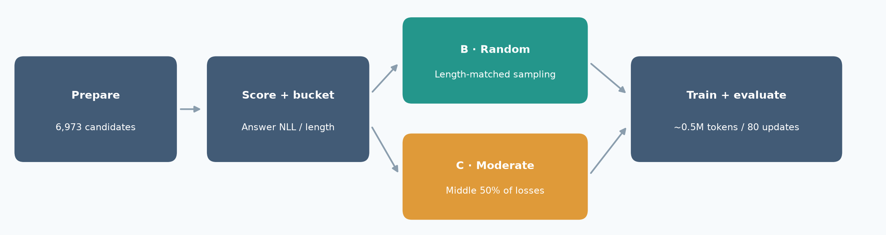

<div align="center">

# GSM8K · Budget-Constrained LoRA

**Compare random and moderate-loss data selection at a matched token budget.**

Qwen2.5-1.5B-Instruct · GSM8K · LoRA · Single-GPU BF16

[Quick start](#quick-start) · [Experiment pipeline](#experiment-pipeline) · [Results](#results) · [Reproduce the experiments](#reproduce-the-experiments) · [Repository layout](#repository-layout)



</div>

This project studies data selection for small-model mathematical reasoning. The base model scores candidate solutions by their average answer-token loss. Two selection strategies then train separate LoRA adapters with approximately **500,000 training tokens**, matching sequence length, answer length, and example count.

GitHub contains the code, configurations, figures, and compact results. Prepared data, predictions, adapters, logs, and notebook checkpoints are available as browsable folders in the [Hugging Face experiment repository](https://huggingface.co/datasets/tomtom123/7021final-artifacts).

## Quick start

Use Python 3.11 or later and run the following commands from the repository root:

```bash
python -m venv .venv
# Linux / macOS
source .venv/bin/activate
# Windows PowerShell
# .\.venv\Scripts\Activate.ps1

python -m pip install -e ".[notebook]"
python -m jupyterlab notebooks/experiments.ipynb
```

The [experiment notebook](notebooks/experiments.ipynb) switches between the original and RTX 5080 snapshots with `EXPERIMENT` and reads the included results, plots comparisons, checks token budgets, and exercises the answer parser. Later sections provide artifact downloads, per-question analysis, and optional GPU inference and training.

### CUDA environment

Scoring, training, and generation use one NVIDIA GPU with BF16 support. The original experiment used an RTX 5090 with CUDA 12.8; the local reproduction environment uses an RTX 5080 with CUDA 13.0. Installation commands are listed on the [PyTorch versions page](https://pytorch.org/get-started/previous-versions/).

```bash
python -m pip install torch==2.9.1 --index-url https://download.pytorch.org/whl/cu128
python -m pip install -e ".[train,notebook]"
```

The CUDA 13.0 build uses the `cu130` index of the same PyTorch version.

After downloading the experiment files, run `python scripts/check_gpu.py` to check BF16 operations, completion loss, two LoRA updates, adapter saving, and generation with a small randomly initialized Qwen2 model. The [GPU check record](results/gpu-check.json) contains the observed environment and results.

Detailed commands and recovery steps are in the [server workflow](docs/server-workflow.md) (Chinese).

## Experiment pipeline

| Group | Method | Training data |
| --- | --- | --- |
| A · Base | Original instruction model | Direct generation with the shared prompt |
| B · Random | Length-bucketed random selection + LoRA | Complete examples sampled to each bucket's token quota |
| C · Moderate | Moderate-loss selection + LoRA | Samples from the middle 50% of loss ranks in each length bucket |

1. Hold out 500 validation questions from the official GSM8K training split, leaving 6,973 candidates.
2. Remove calculation annotations, apply the shared chat template, and supervise assistant answers and EOS tokens.
3. Score the candidate pool with the base model. Each strategy selects roughly 2.5K examples and trains for one pass, totaling 80 updates.
4. Evaluate all 500 validation questions and 1,319 test questions with greedy decoding, recording numerical accuracy, answer formatting, generation length, time, and memory.

Selection and evaluation rules are described in the [methodology](docs/methodology.md); the [project plan](docs/project-plan.md) covers the research design. Both guides are in Chinese.

## Results

Original run: training seed **13**, split seed **2026**, approximately **0.5M training tokens**, RTX 5090.

| Method | Test accuracy | Valid answer format | Mean generated tokens | Scoring + training |
| --- | ---: | ---: | ---: | ---: |
| A · Base | **66.94%** | 16.60% | 182.71 | 0 s |
| B · Random | 62.17% | 98.64% | 91.65 | 75.58 s |
| C · Moderate | 62.32% | 99.17% | 89.82 | 113.42 s |


Both SFT runs improve answer formatting and shorten responses. Their primary accuracy is below the base model. C answers two more test questions correctly than B, a difference of **+0.15 percentage points**. The paired bootstrap 95% interval is **[−1.52, +1.90] percentage points**, spanning zero. Each strategy uses one training seed.

The primary metric parses the final `####` field, with a fixed last-line numerical fallback when the marker is absent. Costs use CUDA-synchronized stage wall time; model download and loading are measured separately. See the [test table](results/seed13/summary_test.csv), [validation table](results/seed13/summary_validation.csv), and [experiment analysis](docs/experiment-analysis.md) (Chinese).

### RTX 5080 rerun

A complete rerun in a separate Python 3.11.9 / PyTorch 2.9.1+cu130 environment rescored all candidates, trained both adapters for 80 updates each, and evaluated every validation and test question. CPU verification passed for all **5,457 new predictions**.

| Method | Original RTX 5090 test | RTX 5080 rerun test |
| --- | ---: | ---: |
| Base | 66.94% | 68.46% |
| Random LoRA | 62.17% | 62.55% |
| Moderate-loss LoRA | 62.32% | 62.70% |

The rerun uses microbatch 2 with 16 accumulation steps, keeping the effective batch at 32. Recomputed losses and selected examples differ across the two execution configurations. See the [RTX 5080 result record](results/rtx5080/README.md) for budgets, costs, validation results, and the paired comparison. The complete files are browsable under [Hugging Face / rtx5080](https://huggingface.co/datasets/tomtom123/7021final-artifacts/tree/main/rtx5080).

## Reproduce the experiments

### Download and verify the original files

```bash
python -m pip install -e ".[hub]"
python -m gsm8k_lora.artifacts fetch
python -m gsm8k_lora.reproduce --report artifacts/verification.json
```

The downloader retrieves the `seed13/` folder at a pinned Hugging Face revision and places the files in local `artifacts/`. CPU verification recomputes the data fingerprint, selections, training budgets, grading of all 5,457 saved predictions, both result tables, and paired bootstrap comparisons. The saved [verification record](results/seed13/reproduction.json) contains the outcome.

With existing local artifacts, run the verification command directly. Use `--destination` to download into another empty directory.

### Start from data preparation

A fresh clone has an empty artifact directory. These commands prepare the data, score candidates, select training examples, and run the two training conditions:

```bash
python -m gsm8k_lora.prepare
python -m gsm8k_lora.run score
python -m gsm8k_lora.select_data

python -m gsm8k_lora.run train --method random --seed 13
python -m gsm8k_lora.run train --method moderate --seed 13

python -m gsm8k_lora.run eval --method base --split validation
python -m gsm8k_lora.run eval --method random --seed 13 --split validation
python -m gsm8k_lora.run eval --method moderate --seed 13 --split validation
python -m gsm8k_lora.summarize --split validation
```

[configs/default.json](configs/default.json) pins the original model and dataset commits. Its `data_dir` and `output_dir` paths resolve relative to the configuration file. Keep custom configurations in `configs/` and select one with `--config configs/my-experiment.json`. Freeze the shared settings before final testing, then run the same evaluation commands with `--split test`.

With prepared data available, run a separate experiment with a microbatch of 2 and 16 accumulation steps, preserving an effective batch of 32:

```bash
python scripts/reproduce_gpu.py --batch-size 2
```

The controller rescores the candidate pool, trains B/C, and evaluates all three groups on the complete validation and test splits. Each stage saves logs and completion status. Choose a fresh `--output` for another run; completed results are protected against overwriting.

## Repository layout

```text
7021final/
├── configs/                 # Executable experiment settings
├── docs/                    # Methods, analysis, workflows, and figures
├── notebooks/
│   └── experiments.ipynb    # Result analysis and optional GPU experiments
├── requirements/            # Training and notebook installation entries
├── results/
│   ├── seed13/             # Original summaries, provenance, and CPU verification
│   ├── rtx5080/            # Complete GPU rerun, summaries, and CPU verification
│   └── gpu-check.json      # Isolated-environment GPU check
├── scripts/                 # Figure generation and GPU reproduction commands
├── src/gsm8k_lora/          # Data preparation, selection, training, and evaluation
├── tests/                   # Configuration, grading, and artifact-copy checks
├── artifacts/               # Local generated/downloaded files, ignored by Git
├── pyproject.toml
└── README.md
```

Logs, model weights, checkpoints, and notebook autosaves retain their directory structure on Hugging Face. The local course review PDF is preserved and excluded from Git tracking.
