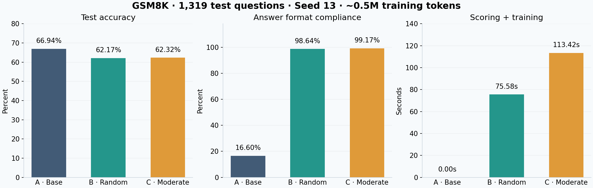

<div align="center">

# GSM8K · Budget-Constrained LoRA

**在相同 token 預算下，比較隨機選樣與中等損失選樣。**

Qwen2.5-1.5B-Instruct · GSM8K · LoRA · 單卡 BF16

[快速開始](#快速開始) · [實驗流程](#實驗流程) · [實驗結果](#實驗結果) · [重現實驗](#重現實驗) · [目錄結構](#目錄結構)


</div>

本專案研究小模型數學解題的資料選擇：用原始模型對候選解答計算平均損失，再比較兩種選樣策略的 LoRA 微調效果與成本。兩組使用約 **500,000 個訓練 token**，並匹配完整序列長度、回答長度與樣本數。

程式、設定與精簡結果保存在 GitHub；完整資料、逐題預測、adapter、日誌和 notebook 暫存檔集中於 [Hugging Face 實驗產物庫](https://huggingface.co/datasets/tomtom123/7021final-artifacts)。

## 快速開始

使用 Python 3.11 以上版本，從倉庫根目錄安裝：

```bash
python -m venv .venv
# Linux / macOS
source .venv/bin/activate
# Windows PowerShell
# .\.venv\Scripts\Activate.ps1

python -m pip install -e ".[notebook]"
python -m jupyterlab notebooks/experiments.ipynb
```

[實驗 notebook](notebooks/experiments.ipynb) 可直接讀取倉庫內的精簡結果，繪製比較圖、檢查 token 預算，並測試答案解析。完整產物載入、逐題分析與 GPU 實驗集中在後半部，透過開關啟用。

### GPU 環境

評分、訓練與生成使用一張支援 BF16 的 NVIDIA GPU。原始實驗使用 RTX 5090；獨立重現環境使用 RTX 5080。CUDA 12.8 安裝方式見 [PyTorch 官方版本頁](https://pytorch.org/get-started/previous-versions/)。

```bash
python -m pip install torch==2.9.1 --index-url https://download.pytorch.org/whl/cu128
python -m pip install -e ".[train,notebook]"
```

下載完整產物後，可先執行 `python scripts/check_gpu.py`，以小型隨機初始化的 Qwen2 檢查 BF16、completion loss、兩步 LoRA 訓練、adapter 儲存與生成。[GPU 檢查紀錄](results/gpu-check.json) 保存了獨立環境的執行結果。

完整命令與失敗恢復方式見 [伺服器操作流程](docs/server-workflow.md)。

## 實驗流程

| 組別 | 方法 | 訓練資料 |
| --- | --- | --- |
| A · Base | 原始指令模型 | 使用共同提示直接生成 |
| B · Random | 長度分桶隨機選樣 + LoRA | 各桶按 token 配額抽取完整樣本 |
| C · Moderate | 中等損失選樣 + LoRA | 各桶保留損失排名中間 50%，再依配額抽樣 |

1. 從 GSM8K 官方訓練集固定抽出 500 題驗證資料，保留 6,973 題作為候選池。
2. 清除訓練答案的計算註記，套用共同 chat template，僅監督 assistant 解答與 EOS。
3. 原始模型為候選池評分，兩種策略各選約 2,543 題，訓練一遍、共 80 個更新步。
4. 在完整驗證集與 1,319 題測試集上使用貪心生成，統計數值準確率、格式與成本。

詳細規則見 [方法與評估](docs/methodology.md)，研究設計見 [專案方案](docs/project-plan.md)。

## 實驗結果

原始紀錄：訓練種子 **13**、資料切分種子 **2026**、約 **0.5M token**、RTX 5090。

| 方法 | 測試準確率 | 合法答案格式 | 平均生成 token | 評分 + 訓練 |
| --- | ---: | ---: | ---: | ---: |
| A · Base | **66.94%** | 16.60% | 182.71 | 0 秒 |
| B · Random | 62.17% | 98.64% | 91.65 | 75.58 秒 |
| C · Moderate | 62.32% | 99.17% | 89.82 | 113.42 秒 |



兩組微調提高了格式遵循率、縮短了回答，主準確率低於原始模型。C 比 B 多答對 2 題，相差 **+0.15 個百分點**；配對 bootstrap 95% 區間為 **[−1.52, +1.90] 個百分點**。這次單種子結果尚未顯示中等損失選樣的明確優勢。

主準確率使用 `####` 數值欄位，缺少標記時使用預先固定的末行數值回退。成本記錄 CUDA 同步後的階段牆鐘時間，模型下載與載入另計。原始表格見 [測試結果](results/seed13/summary_test.csv)、[驗證結果](results/seed13/summary_validation.csv)；逐題案例與成本分析見 [實驗分析](docs/experiment-analysis.md)。

## 重現實驗

### 下載與核對原始產物

```bash
python -m pip install -e ".[hub]"
python -m gsm8k_lora.artifacts fetch
python -m gsm8k_lora.reproduce --report artifacts/verification.json
```

下載器取得固定 Hugging Face revision 的 `seed13/` 目錄，將原始檔案放到本地 `artifacts/`。CPU 核對會重算資料 fingerprint、選樣、訓練預算、5,457 筆預測的數值判分、兩個 split 的結果表與配對 bootstrap。核對紀錄見 [reproduction.json](results/seed13/reproduction.json)。已有本地產物時可直接執行核對命令；下載可用 `--destination` 指定空目錄。

### 從資料準備開始

新 clone 的 `artifacts/` 為空，以下命令會建立新的實驗資料與結果：

```bash
python -m gsm8k_lora.prepare
python -m gsm8k_lora.run score
python -m gsm8k_lora.select_data

python -m gsm8k_lora.run train --method random --seed 13
python -m gsm8k_lora.run train --method moderate --seed 13

python -m gsm8k_lora.run eval --method base --split validation
python -m gsm8k_lora.run eval --method random --seed 13 --split validation
python -m gsm8k_lora.run eval --method moderate --seed 13 --split validation
python -m gsm8k_lora.summarize --split validation
```

設定在 [configs/default.json](configs/default.json)，固定原始實驗的模型與資料 commit SHA，`data_dir` 與 `output_dir` 相對於設定檔所在目錄解析。自訂設定放在 `configs/` 下，透過 `--config configs/my-experiment.json` 指定。正式測試前固定設定，將上述評估的 `--split validation` 換成 `--split test`。

已有準備資料時，可在獨立目錄重新評分、訓練 B/C 並評估完整驗證與測試集：

```bash
python scripts/reproduce_gpu.py
```

各階段逐項保存日誌與完成狀態。新一輪實驗請指定新的 `--output`；每個階段會保護已存在的結果。

## 目錄結構

```text
7021final/
├── configs/                 # 可執行的實驗設定
├── docs/                    # 方法、分析、操作流程與圖片
├── notebooks/
│   └── experiments.ipynb    # 結果分析與可選 GPU 實驗
├── requirements/            # 訓練與 notebook 安裝入口
├── results/
│   ├── seed13/             # 精簡結果、原始設定與 CPU 核對紀錄
│   └── gpu-check.json      # 獨立環境的 GPU 執行檢查
├── scripts/                 # 繪圖與獨立 GPU 重現入口
├── src/gsm8k_lora/          # 資料準備、選樣、訓練、評估與產物管理
├── tests/                   # 路徑、解析與封存還原測試
├── artifacts/               # 本地產物，下載或執行後建立，Git 忽略
├── pyproject.toml
└── README.md
```

日誌、模型權重、checkpoint 與 notebook 暫存檔按原有目錄集中保存至 Hugging Face。本地 review report 保留原檔，透過 `.gitignore` 排除。
